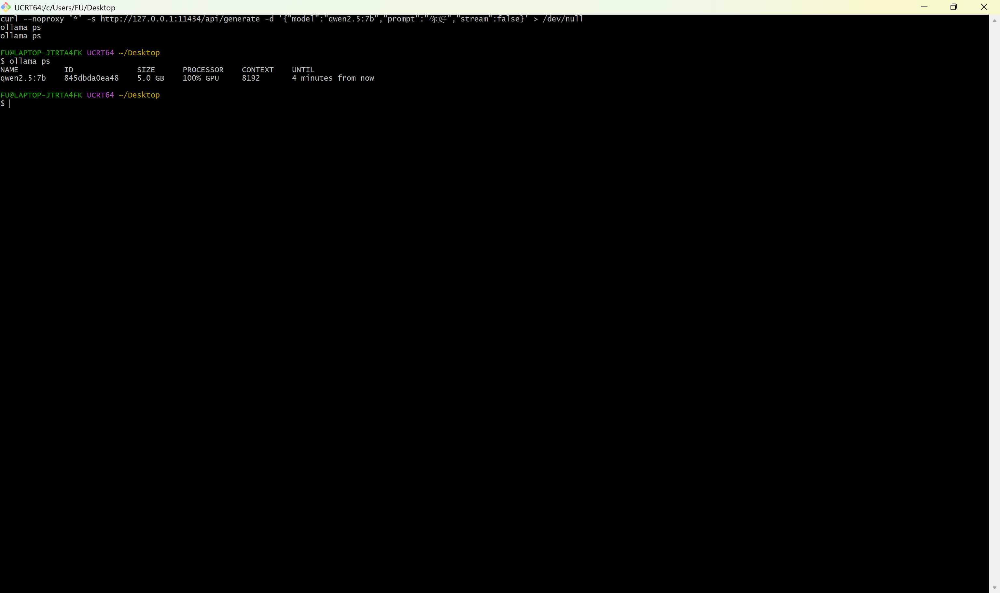
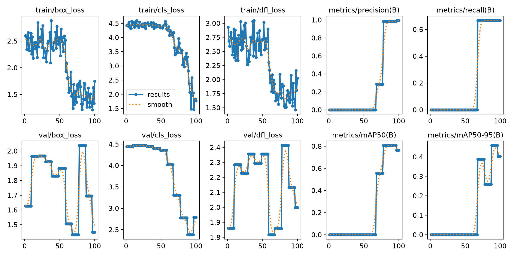
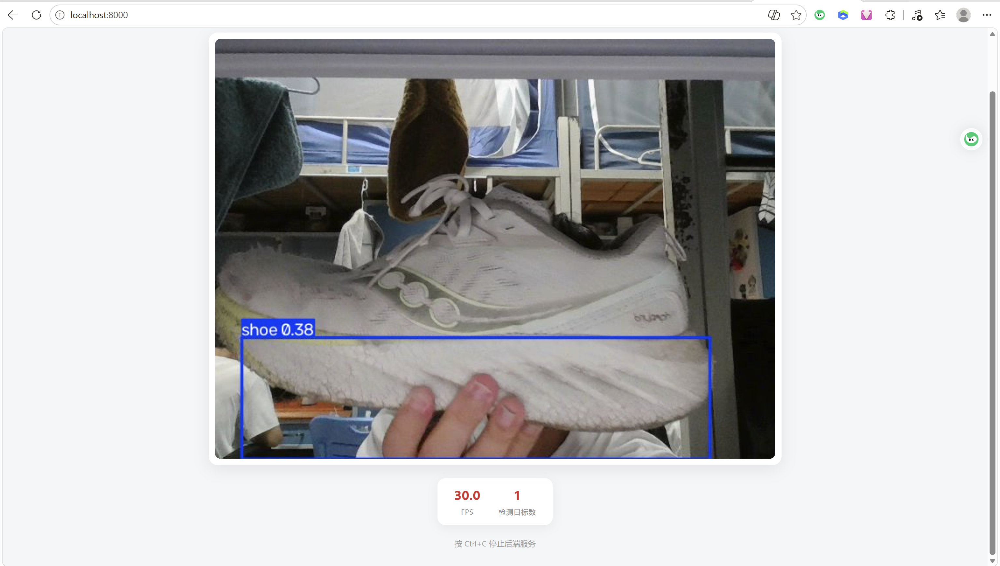
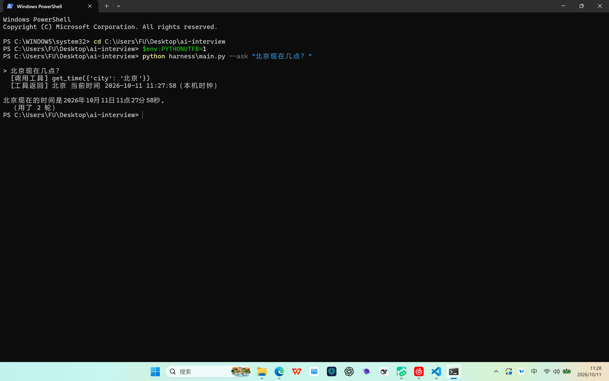
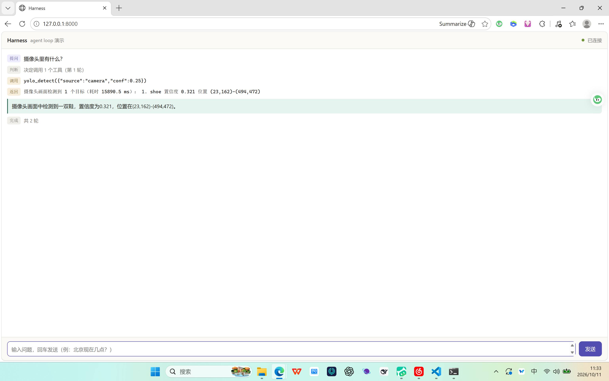

# AIU创智部二面实战部分 说明文件

> **进度**：任务一 · 大模型 ✅ ｜ 任务二 · YOLO ✅ ｜ 任务三 · 硬件结合 ⏭️ **未做**（无单片机）｜ 任务四 · Harness ✅ ｜ 任务五 · 创意作品 ✅
> 除任务三受硬件条件限制跳过外，其余任务均已完成并实机验证 —— **项目到此收尾**。

## 目录结构

```
ai-interview/
├─ llm/                   本地大模型：部署、性能测试、智能体与 API 接入
│  ├─ llm_README.md
│  ├─ agent/              智能体与 API 接入（CLI / Web）
│  └─ test/               测试报告 ｜ 原始数据 ｜ 复现脚本 ｜ 截图
├─ yolo/                  视觉部分（任务二：训练与实时推理）
│  ├─ yolo_README.md
│  ├─ main.py             训练入口（组装模型 + 配置 + 参数）
│  ├─ config/             train.yaml ｜ dataset.yaml
│  ├─ script/             resize.py ｜ json2txt.py ｜ DataProess.py
│  ├─ your_data/ your_data2/   两轮数据（示例 10 张 / 自采 60 张）
│  ├─ first_train/        第一轮训练产物归档
│  └─ infer/              摄像头实时推理（后端 app.py ｜ 前端 index.html）
├─ harness/               LLM Agent 运行时（任务四）
│  ├─ harness_README.md
│  ├─ main.py             组装入口（只接线）
│  ├─ cli.py ｜ web/      两个前端（只订阅事件）
│  ├─ core/               ≈ pi-agent-core：loop ｜ registry ｜ executor ｜ events ｜ context
│  ├─ backend/            ≈ pi-ai：网关抽象 + Ollama 适配器
│  ├─ tools/              可插拔工具 ×6
│  └─ test/               跑通验证截图 + test_README.md
├─ football/              创意作品（任务五：AI 战术分析师）
│  ├─ football_README.md
│  ├─ app.py              Flask 全栈后端（只组装 vision + tactics + brain + players + career）
│  ├─ analyze_cli.py      命令行入口（兼供 Harness 子进程调用）
│  ├─ desktop.py ｜ app.ico ｜ 启动.bat    桌面启动器 / 图标 / 一键启动
│  ├─ static/index.html   前端（六个页签，单文件 SPA）
│  ├─ vision/（帧输入 → 检测 → 分队 → 攻防）｜ tactics/ ｜ brain/ ｜ players/ ｜ career/
│  ├─ data/               球员数据集 CSV ｜ career.db（不入库）｜ 备用源
│  └─ test/               自测脚本 + 结果 + 截图
├─ log.md                 工程日志（按天记录进展与卡点）
└─ README.md
```

## 任务一 · 大模型：本地部署 ✅

| 项 | 值 |
|---|---|
| GPU | NVIDIA RTX 5070 Laptop（8151 MB 显存） |
| 内存 | 32 GB DDR5 |
| 驱动 | 610.74（PyTorch 需 CUDA 12.8+ 的 wheel） |
| 运行时 | Ollama v0.35.1 ｜ qwen2.5:7b（7.6B / Q4_K_M / 4.7 GB） |

> 模型存放在 `D:\OllamaModels`（用 `OLLAMA_MODELS` 从 C 盘迁出），服务地址 `http://127.0.0.1:11434`。

| 指标 | 冷启动 | 热启动 |
|---|---:|---:|
| 首字延迟 TTFT | 5.46 s | **0.03 s** |
| 生成速度 | 59.0 tok/s | 55.6 tok/s |
| 显存占用 / 运行位置 | 4.8 / 8 GB ｜ 100% GPU | 同左 |

**结论**：冷启动瓶颈是**模型加载**（5.33 s，占总耗时 58%），不在推理；模型驻留后首字降到 0.03 s，生成稳定在 55–60 tok/s。

完整报告 [`llm/test/test_report.md`](llm/test/test_report.md) ｜ 部署步骤 [`llm/llm_README.md`](llm/llm_README.md) ｜ 一键复现 `bash llm/test/bench.sh`



## 任务二 · YOLO ✅

**路线**：沿用出题人博客《从零开始搭建自己的 YOLO》及配套仓库 [`Linmoqian/yolo_train`](https://github.com/Linmoqian/yolo_train) 的现成流程（`json2txt.py` → `DataProess.py` → `main.py`），本机只在**环境**与**数据**上适配，流程本身不改。

| 项 | 值 |
|---|---|
| 虚拟环境 | `D:\envs\yolo`（Python 3.14 + `venv`，不占系统盘） |
| PyTorch / Ultralytics | 2.11.0+cu128 ｜ 8.4.173 ｜ OpenCV 5.0.0 ｜ Flask 3.1.3 |
| 数据集（一 / 二轮） | 示例 10 张 `nc=2`（cat/dog）｜ 自采 60 张 `nc=1`（shoe） |
| 标注工具 | X-AnyLabeling |

**三处对出题人原版的必要偏离**（详见 [`yolo/yolo_README.md`](yolo/yolo_README.md)）：① 必须用 **cu128** 的 wheel（RTX 5070 是 Blackwell / sm_120，低版本会 `no kernel image is available`）；② 用 `venv` 而非 Miniforge（C 盘紧张，可整体建在 D 盘）；③ `main.py` 加 `if __name__ == '__main__':`（Windows 下 DataLoader spawn 会二次执行 `train()`）。

| 轮次 | 数据 | 类别 | 耗时 | mAP50 | 归档 |
|---|---|---|---|---|---|
| 第一次 | 出题人示例 10 张 | cat / dog | 59 s | 0.866 | [`yolo/first_train/`](yolo/first_train/first_train_README.md) |
| 第二次 | **自采 60 张鞋子** | shoe | 2.66 min | **0.882** | `yolo/runs/.../exp-2` |

> ⚠️ 两轮均为小样本，指标只用于确认**管道打通**。



**摄像头实时推理**（[`yolo/infer/`](yolo/infer/infer_README.md)）：Flask 后端 + HTML 前端，前端只订阅、后端只计算推送。实测帧率稳定 **30 FPS**：

```bash
cd yolo\infer
D:\envs\yolo\Scripts\python.exe app.py     # 浏览器打开 http://localhost:8000
```



> 踩过的坑：训练图是手机俯拍特写（目标大、光线足），摄像头是平视 + 台灯直射过曝，一度「真鞋检不出、手机屏幕里的鞋照片反而能检出」——属**域差异**，避开过曝、让目标占画面 1/3 以上即可。根治方向是用**同一个摄像头在实际场景补拍数据重训**。

## 任务四 · Harness ✅

**是什么**：Harness 是套在 LLM 外面的运行时外壳（词源本意即"挽具"）。模型只会"说"，Harness 让它能"做"：把动作编码成 `tool_calls` 交给 executor 代跑、把消息列表外存、用循环包住一次前向。

**架构对齐 `piagent`**（题目提示的分层，对应 `earendil-works/pi`）：

| 本项目 | piagent 对应层 | 职责 |
|---|---|---|
| `harness/core/` | `pi-agent-core` | agent loop ｜ 工具注册表 ｜ 执行器 ｜ 事件总线 ｜ 上下文 |
| `harness/backend/` | `pi-ai` | LLM 网关：抽象接口 + Ollama 适配器 |
| `harness/cli.py` ｜ `harness/web/` | `pi-coding-agent` | 应用层：终端前端 / 浏览器前端 |

**三条铁律守住 `core/` 不变**：不认模型（无 `if model == ...`）、不认工具（无具体工具名）、不 `print`（只 `emit` 事件）。加一个工具只需在 `tools/` 按契约新建文件、在 `main.py` 注册一行 —— `core/` 一字不改，两条路径均已实测。

**与任务二打通**：把 YOLO 封为 `yolo_detect` 工具。难点是**跨解释器**（harness 只用标准库，而 torch / ultralytics 在 `D:\envs\yolo`），用子进程桥接：

```
harness ──subprocess──► D:\envs\yolo\Scripts\python.exe ──► yolo\detect_cli.py ──► stdout: JSON
```

代价是每次调用都要冷启动重载模型（首次约 13 s，热缓存后约 2.5 s）——**刻意的取舍**：做成常驻服务更快，但两边就耦合了；现在 `core` 对 YOLO 的存在完全无感。

**实机验证**（2026-10-11，[`harness/test/`](harness/test/test_README.md)）：① 模型自主调用 `get_time` ✅ ② 问「你好」直接回答、**不调**工具 ✅ ③ 工具执行中事件已实时推送前端 ✅ ④ YOLO 跨解释器接入（冷启 15.9 s）✅。第 1、2 条是**同一份代码、同一份工具表**，没有任何写死分支 —— 这就是控制反转。




> 诚实记录：第 4 张里模型报「检测到一双鞋」属**误检**（置信度 0.321），根因是数据集**没有负样本**（54 张图张张有鞋，模型未建立"背景"概念），与 Harness 架构无关。本次目标是**跑通**，已达成。

**规模**：18 个 Python 文件 / 约 800 行，**零第三方依赖**。原理见 [`harness/harness_README.md`](harness/harness_README.md)。

## 任务五 · 创意作品：AI 战术分析师 ✅

> 拍一张球场画面 → 分出两队 → 判出谁在进攻谁在防守 → 指出哪条通道有空当 → 本地大模型推演**球接下来可能怎么走**。

**为什么是它**：题目任务四写着「尽情结合你的**专业方向和兴趣方向**」—— 兴趣 = 足球。它把前四个任务的积木串了起来：

| 功能 | 复用到的已有能力 |
|---|---|
| ① 判**谁在进攻 / 谁在防守** | 任务二 YOLO：COCO 权重本就有的 `person`（**零训练**） |
| ② 指出**空当通道** | 球员站位 → 沿通道轴分三段看防守方哪段人最少（纯几何） |
| ③ 推演**球可能的发展** | 任务一本地大模型 qwen2.5:7b |
| ④ **战术问答** | 任务四 Harness 的上下文机制 + 前端 |
| ⑤ **手动战术板**（自己排兵布阵） | 构造等效坐标喂给**同一个**判定内核 |
| ⑥ **我的足球生涯**（自建球员 / 比赛 / 统计） | 标准库 SQLite + 位置加权总评（**零新增依赖**） |

> **刻意的「减法」**：**不做球队识别，也不硬套 4-3-3 这类阵型名** —— 静态单帧支撑不起精确阵型，与其编得人模人样，不如只给两件真能用的结论：谁压上、球往哪走。

**分层**（前后端解耦）：

```
输入（两条路，同一个判定内核）
   截图 ──────────────┐
   战术板（手动摆位）──┴──► vision/pitch.py 判攻防 + 找空当 ──► brain/（LLM 态势/发展/问答）
                                  │
                       app.py（Flask 只组装）──HTTP──► static/index.html（只显示）
```

视觉层直接用 COCO 权重里已有的 `person`(id 0)，**零标注、零训练、零新增依赖**；视觉是纯计算，想换后端只改 `brain/`，`vision/` 一字不动。

**手动战术板**：COCO 认不出高位/俯视画面里的球员（而那正是战术分析最需要的视角），于是补一条**绕过检测**的路 —— 自己把球员拖上场、标成我方/对手、放上球。要点是 `vision/pitch.py` **只认坐标**，不关心坐标来自 YOLO 还是鼠标，所以战术板只需构造等效矩形，攻防判定 / 三区人数 / 空当通道全部原样复用，**两条输入路径的结论口径天然一致**。附带 5 套常用站位当**起点**（不是阵型约束）。

**我的足球生涯**：自建球员（拖六维滑块即时看总评）→ 排兵布阵（可存档）→ 录入比赛与出场明细 → 生涯战绩 / 射手榜 / **能力成长曲线**。两个设计点：**总评不落库**（每次现算，调权重全库自动跟上）、**删球员不删战绩**（只解绑 `player_id`，他作为「历史球员」继续留在生涯表里）。

**球员库**（本地 EA FC 数据集 + TheSportsDB）：

| 能力 | 实现 | 实测 |
|---|---|---|
| 搜索球员 | 本地 CSV 建索引（名字归一化 + 词序无关兜底） | 18494 人 ｜ ~1.0 s |
| 能力榜 | 11 个维度 × 位置过滤 | ~10 ms |
| 能力卡 | 本地评分 + 在线头像 / 简介 | ~1.2 s |
| **断网时** | 静默降级为纯离线卡 | 有评分、无头像，**不报错** |

> **评分离线、头像在线**：18494 人的能力值随仓库分发，断网可用。详见 [`football/players/players_README.md`](football/players/players_README.md)。

**已接入 Harness**：`football_tactics`、`football_players`、`football_career` 三个工具 —— 分别让 Agent 会「看球」、会「查真实球员」、会「读我的生涯数据」。`football_career` 刻意**只做读**：自建球员与录入比赛留在前端表单里，不放开给模型自由填。

**已知局限**（详见 [`football/vision/vision_README.md`](football/vision/vision_README.md)）：只吃高位/侧高位视角（纯俯视下 COCO 认不出人；画面的纵深轴按转播机位约定取横轴，竖向取景请走战术板）；**草地背景会污染球衣取色** ⇒ 已改为「胸区取样 + 剔除草地色 + 色相主峰 + 黑白球衣走亮度通道」；**看台观众混进来** ⇒ 按「框底边草地占比」剔掉；**异色门将会被踢出攻防统计**（深色球衣的门将取样区易落到草地，色相离本队色心仅 ~23°，靠 `gk_tol=22°` 才能挡住；黑衣裁判仍可能漏网）；**整屏截图里球只有 ~12px，整图推理检不出** ⇒ 改为「裁到球场 + 球员脚边开窗找球」（置信度 0.29 → 0.78），**漏检就不判攻守（相持）**不硬猜。均为**已知取舍**。

**测试证据**（[`football/test/`](football/test/test_README.md)）：接口自测 **47/47**、球衣分队自测 **10/10**、攻守判定自测 **15/15**。

```bash
cd football
D:\envs\yolo\Scripts\python.exe app.py --port 8100        # 浏览器打开 http://127.0.0.1:8100
D:\envs\yolo\Scripts\python.exe analyze_cli.py --source shot.jpg --advise   # 或命令行
```

## 怎么跑起来

需要 Windows + 一张 ≥ 8 GB 显存的 N 卡；智能体链另外需要 Docker Desktop。

```bash
# ① 本地大模型（Ollama）
ollama serve                          # 服务化，监听 11434
ollama pull qwen2.5:7b                # 拉模型，约 4.7 GB
ollama run qwen2.5:7b "你好"           # 冒烟测试

# ② 智能体链（Dify，15 个容器）
cd D:\dify && docker compose up -d    # Dify 源码目录（按实际路径改），起来后访问 http://localhost
#   在 Dify 中安装 Ollama 插件并添加模型（Base URL 用 host.docker.internal:11434）
#   → 新建「聊天助手」并「发布」→「访问 API」取得 app-xxxx 密钥

# ③ 应用接入（CLI / Web）
cd llm/agent
export DIFY_API_KEY="app-xxxxxxxx"    # PowerShell 写：$env:DIFY_API_KEY="app-xxxxxxxx"
python cli.py                         # 终端多轮对话
python server.py                      # Web 界面 http://127.0.0.1:8000

# ④ 复现性能测试
bash llm/test/bench.sh

# ⑤ 任务二 · YOLO（独立虚拟环境，与上面的 llm 链互不干扰）
cd yolo                                     # 必须在本目录执行：脚本里用的是相对路径
D:\envs\yolo\Scripts\python.exe script\json2txt.py      # json 标注 → YOLO txt
D:\envs\yolo\Scripts\python.exe script\DataProess.py    # 划分 train / val / test
D:\envs\yolo\Scripts\python.exe main.py                 # 训练，产出 runs/.../weights/best.pt

# ⑥ 摄像头实时推理
cd yolo\infer
D:\envs\yolo\Scripts\python.exe app.py                  # 浏览器打开 http://localhost:8000

# ⑦ 任务四 · Harness（只用标准库，无需安装依赖，也无需激活 venv）
cd harness
python main.py --ask "北京现在几点？"                     # 单次提问，跑完即退出
python main.py                                          # 终端交互模式
python main.py --web --port 8080                        # Web 界面（避开 ⑥ 占用的 8000）

# ⑧ 任务五 · AI 战术分析师（视觉用 yolo 的 venv；建议 Ollama 在跑）
cd football
D:\envs\yolo\Scripts\python.exe app.py --port 8100      # 浏览器打开 http://127.0.0.1:8100
D:\envs\yolo\Scripts\python.exe analyze_cli.py --source shot.jpg --advise   # 或命令行
#   也可以直接双击桌面「AI 战术分析师」图标（无控制台窗口；启动器见 football/desktop.py）
#   界面六个页签：战术分析 ｜ 战术板 ｜ 我的球队 ｜ 比赛记录 ｜ 生涯 ｜ 球员库
#   生涯数据存在 football/data/career.db，首次运行自动创建
```

各子链路的完整步骤见对应目录：

- **大模型链** → [`llm/llm_README.md`](llm/llm_README.md) ｜ **智能体链** → [`llm/agent/agent_README.md`](llm/agent/agent_README.md)
- **视觉链** → [`yolo/yolo_README.md`](yolo/yolo_README.md) ｜ **Harness** → [`harness/harness_README.md`](harness/harness_README.md)
- **创意作品** → [`football/football_README.md`](football/football_README.md) ｜ **球员库** → [`football/players/players_README.md`](football/players/players_README.md)
- **战术板** → [`football/tactics/tactics_README.md`](football/tactics/tactics_README.md) ｜ **我的生涯** → [`football/career/career_README.md`](football/career/career_README.md)
- **测试证据** → [`football/test/test_README.md`](football/test/test_README.md) ｜ [`harness/test/test_README.md`](harness/test/test_README.md)

## 进度

| 日期 | 完成内容 |
|---|---|
| 10-01 | 仓库初始化：目录骨架、README、`.gitignore`、工程日志 |
| 10-03 | **任务 1-1**：Ollama 部署、模型目录迁至 D 盘、qwen2.5:7b 服务化、性能测试与报告 |
| 10-04 | **任务 1-2**：Dify 自部署 → Ollama 作 model provider → API 接入；CLI 与 Web 两个自研应用跑通；代码按模块化重组 |
| 10-05 | **任务二启动**：确定 YOLO 路线；建独立 venv（`D:\envs\yolo`），装好 torch 2.11.0+cu128 与 ultralytics；标注 10 张图并完成划分 |
| 10-06 | **训练跑通**：修复 Windows 多进程入口保护问题（`main.py` 加 `if __name__ == '__main__':`）；完成 100 epochs 训练（mAP50 0.866），归档 `yolo/first_train/` |
| 10-07 | **任务二收尾**：新增 `yolo/infer/` 摄像头实时推理与 `script/resize.py`；自采 60 张鞋子图完成第二轮训练（mAP50 0.882）；实时推理实机验证通过（30 FPS） |
| 10-09 | **任务四**：按 `piagent` 分层搭建 Harness（`core` / `backend` / `tools` / 双前端）；把 YOLO 封装为 `yolo_detect` 跨解释器接入 |
| 10-11 | **任务四验证**：Harness 实机跑通（自主调工具 / 对照不调 / Web SSE 实时推送 / YOLO 跨解释器），截图归档 `harness/test/`；**任务五**：完成《AI 战术分析师》—— 截图 → 检测 / 分队 / 判攻防 → LLM 推演球的发展与战术问答 |
| 10-12 | **任务五收敛**：按反馈**做减法** —— 砍掉球队识别与阵型命名，聚焦「判断攻防态势 + 推演球的发展」；修掉两处判定缺陷（越线基准改画面中线、提示词锁定攻防判定权） |
| 10-13 | **任务五扩展**：新增**球员库**（EA FC 18494 人 / 11 维能力榜 / 能力卡）、**手动战术板**、**我的足球生涯**（自建球员 / 阵容 / 比赛 / 成长曲线）；前端扩到六个页签；三个新模块接入 Harness；完成**本地桌面化**（桌面图标一键启动、无控制台窗口） |
| 10-13 | **修 bug**：拿真实直播帧复现出「攻防判定明显不对」，逐层定位到**草地背景污染球衣取色**（取样区内草地像素占 7%~69%）⇒ 重写 `team_split`（胸区取样 + 剔除草地色 + 色相主峰 + 黑白走亮度通道），判不出队的人不再计入攻防统计；自测 10/10、接口回归 46/46 |
| 10-13 | **按工程规范自查并收口两处硬伤**：① 把「抓帧 / 解码」从主程序下沉到 `vision/frames.py`（`app.py` 不再 `import cv2 / numpy`）；② 前端 `index.html` 里那份总评公式删掉，改为拖滑块时问 `POST /api/career/rate` —— 评分公式只留后端一份；补 `football/test/`（接口 46/46、分队 10/10）与测试说明 |
| 10-13 | **修「攻守判反」**：定位到两条根因 —— ① 球在整屏截图里只有 ~12px，`imgsz=1280~2560` 整图推理检不出来，判定只能靠站位猜；② 「越线人数」把画面上下当成了球场纵深（侧高位机位下纵深其实是横轴），且「谁占哪半场」是拿质心反推的，两队挤在同一侧就整体翻过来。改为**谁控球谁进攻**（距离 < 1.2 倍身高），加 `vision/locate.py`（裁到球场 + 清看台 + 脚边开窗找球，球置信度 0.29 → 0.78），轴改为按路径约定死并输出方向词；球没检出就**相持**不硬猜。补 `test_judge.py`（15/15），其中 K6 专钉「numpy 整数混进 `jsonify`」这类坑（`TypeError: Object of type int32 is not JSON serializable`），并在 `app.py` 加了一层 JSON 兜底；顺带修掉 v3 改名后 `analyze_cli.py` / `harness/tools/football_tactics.py` 仍在读旧字段（`ball.zone`、`dist` 当 dict 用）的问题 —— **Harness 那条路已实测跑通** |

| 10-13 | **修「未计入」那一行不显示**：`/api/analyze` 里 `unassigned` 的结构化字段被 `**geo` 展开时**同名覆盖**成裸 int ⇒ 前端读 `a.unassigned.count` 拿到 `undefined`，「未计入（门将 / 裁判）」整行**永远不渲染**（截图里「球员总数 9 = 5 + 3 + 1」却看不到那一行）。调整字段展开顺序，并在接口自测补一条 CHECK（`unassigned` 结构化 + 人数守恒 `players == on_pitch + count`）；接口自测 46 → **47/47** |

逐日过程与卡点见 [`log.md`](log.md)。

## AI 使用情况声明

### 使用的工具

| 工具 | 版本 / 模型 | 主要用途 |
|---|---|---|
| WorkBuddy | 5.6.2 → 5.7.7（内置 DeepSeek V4.1-flash） | 环境排障、技术选型、代码初稿、文档起草与评审 |

### 分工

| 环节 | 主导方 | 说明（举例） |
|---|---|---|
| 环境事实（版本 / 端口 / 进程 / 显存） | **我** | 以本机实测为准 |
| 技术选型 | AI 给候选，**我拍板** | 智能体框架在 Dify / n8n / 纯自研中选定 Dify |
| 系统级操作（安装、代理、Docker 配置） | **我亲手执行** | AI 只提供命令 |
| 代码/脚本编写与实现 | AI 出初稿，**我根据指示跑通测试** | `dify_client.py` / `cli.py` / `server.py` / `index.html` / `harness/` / `football/` |
| 测试与数据 | **我** | 用例由 AI 提供，自己执行、自己截图 |
| README 文档 | 大部分由 AI 完成，我进行删繁就简 | `README` / 测试报告 |
| `log.md` 日志 | 基本全部由我完成，仅复制少量 AI 对话 | `log.md` |

## 待办

- [x] 标注 `your_data/` 10 张图 → `json2txt.py` 转换 → `DataProess.py` 划分 → 训练（yolov8n / imgsz=640 / epochs=100）并归档
- [x] 采集自己的数据（60 张鞋子图）重训并用新模型实时推理（`yolo/infer/`）
- [x] 搭建 Harness 分层骨架，验证「加工具、换前端均不改 `core`」；Web 与终端订阅同一套事件
- [x] 把 YOLO 封装为 `yolo_detect` 工具接入 Harness，并补 `harness/test/`
- [x] 完成创意作品（任务五）：截图判攻防 / 找空当 / 推演球的发展 / 战术问答
- [x] 足球作品扩展球员库（搜索 / 能力榜 / 能力卡）并接入 Harness
- [x] 本地桌面化：桌面图标一键启动（`football/desktop.py` + Edge app 窗口）
- [x] 手动战术板：拖动排兵布阵，复用 `vision/pitch.py` 的判定内核（不复制逻辑）
- [x] 我的足球生涯：自建球员（位置加权总评）/ 阵容存档 / 比赛记录 / 生涯统计与成长曲线，并接入 Harness（只读）
- [x] 补 `football/test/`：接口自测 47/47、分队自测 10/10、攻守判定自测 15/15
- [ ] 给数据集补无目标背景图（**空标签文件**）作负样本，改善 YOLO 工具的误检（可选优化）
- [ ] 补拍实际推理场景的数据混入重训，改善泛化能力（可选优化）
